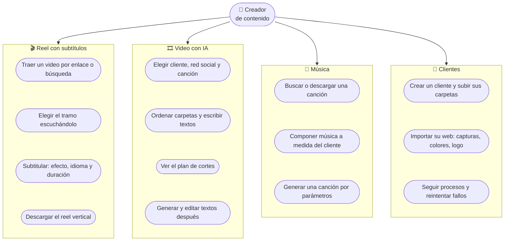
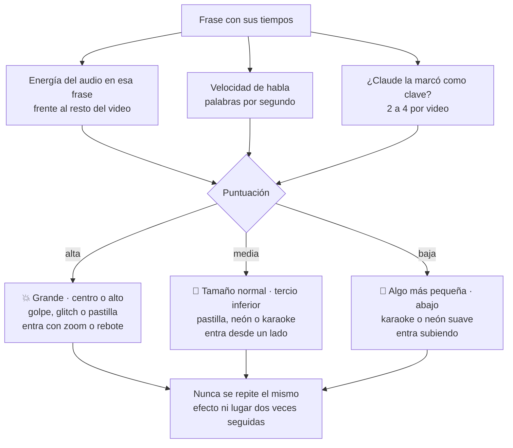
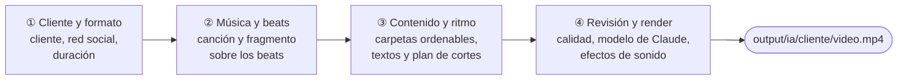
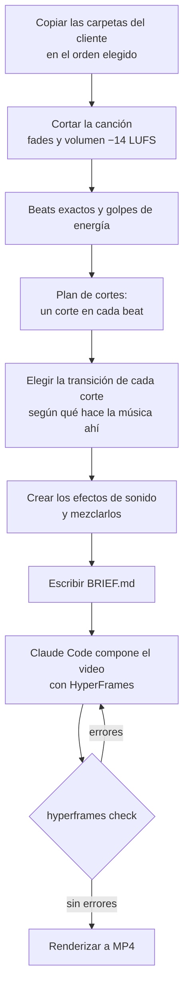
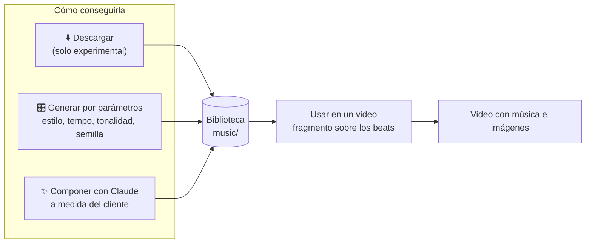
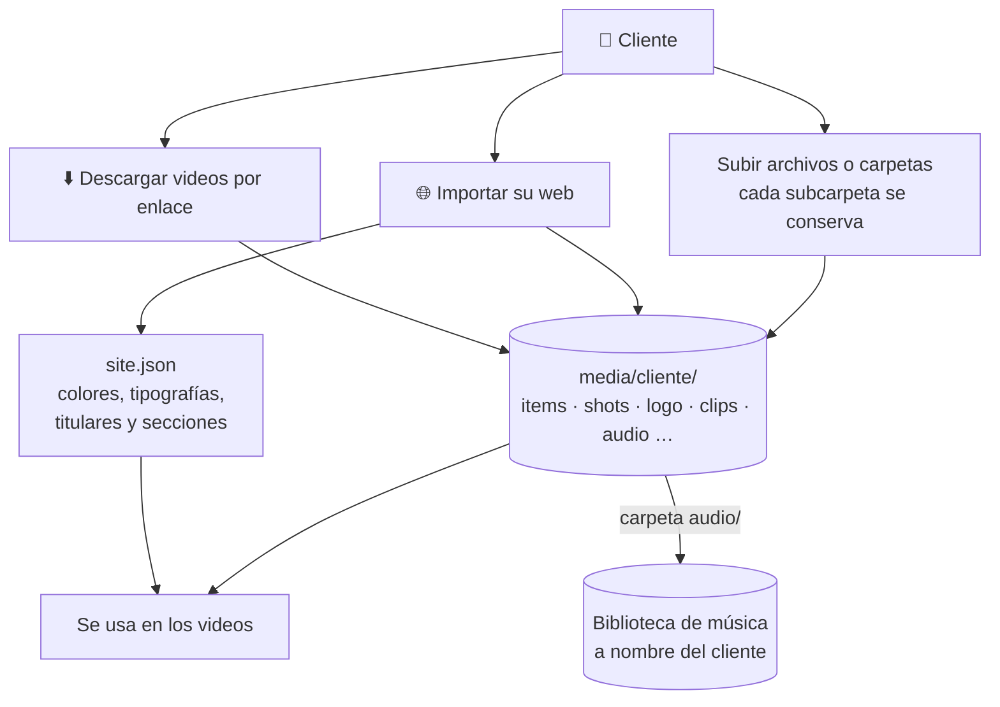
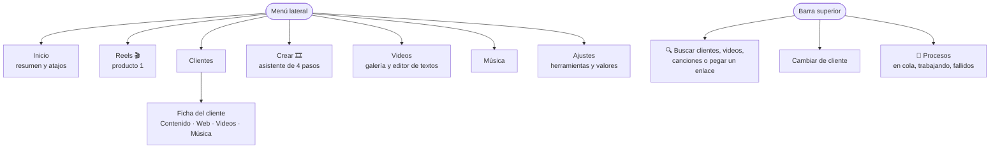
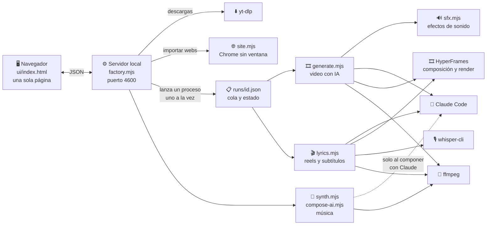
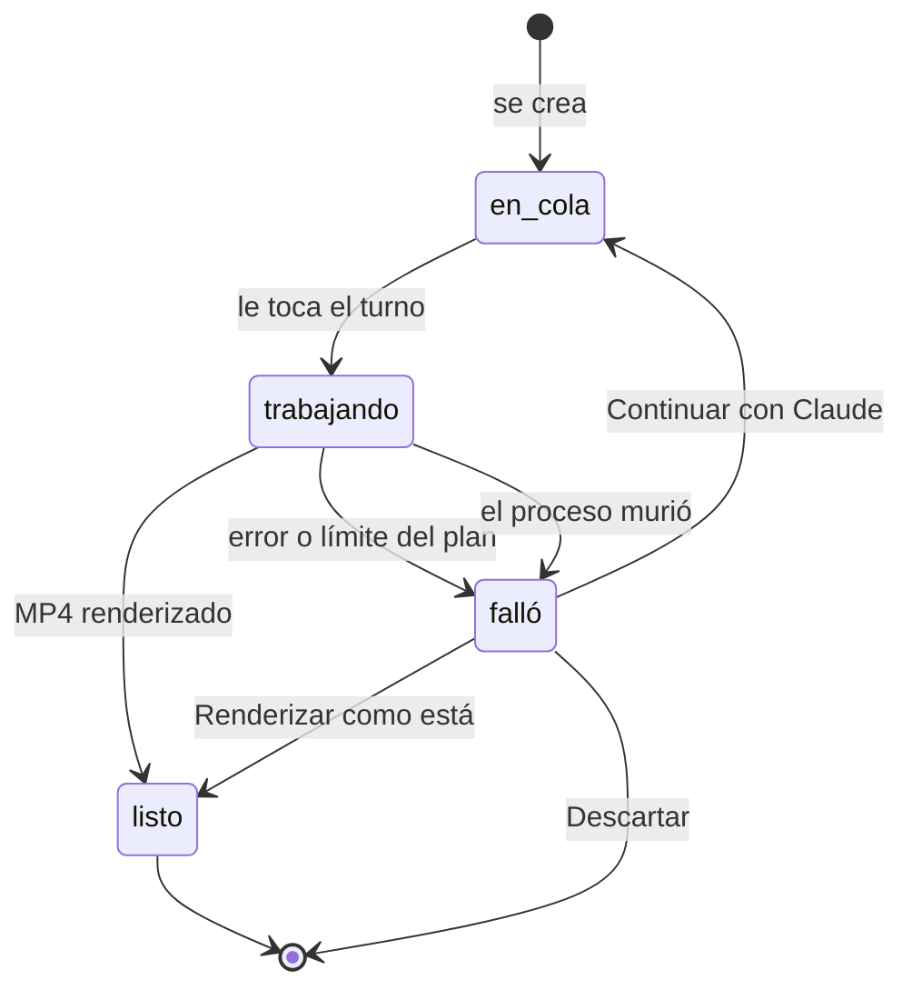

# Video Factory

Una **fábrica de videos cortos para redes sociales**, hecha para trabajar con varios clientes a la vez. Corre en tu computadora, se maneja desde el navegador y usa [HyperFrames](https://hyperframes.heygen.com) para renderizar y Claude Code para componer y traducir.

| Producto | Qué hace | Cuánto tarda |
|---|---|---|
| 🎬 **Reel con subtítulos** *(producto 1)* | Descargas un video de YouTube, Instagram, TikTok…, eliges el tramo y sale un reel vertical subtitulado con efectos, en español, inglés o ambos | ~5–8 min |
| 🎞️ **Video con música e imágenes** | Con las fotos y clips de un cliente y una canción, Claude monta un video con cortes y transiciones sobre el ritmo | ~8–15 min |
| 🎵 **Música a medida** | Canciones compuestas por código, o por Claude leyendo la web del cliente. Sin derechos de terceros | ~3–15 s |
| 📦 **Lotes por plantilla** | Plantillas HTML + un JSON = muchos MP4 de una vez, por terminal | segundos por video |

> **Contenido de este documento:** [Casos de uso](#casos-de-uso) · [Inicio rápido](#inicio-rápido) · [Reel con subtítulos](#-reel-con-subtítulos) · [Video con música e imágenes](#-video-con-música-e-imágenes) · [Música](#-música) · [Clientes y contenido](#-clientes-y-contenido) · [La interfaz](#la-interfaz) · [Arquitectura](#arquitectura) · [Dónde se guarda todo](#dónde-se-guarda-todo) · [Lotes por plantilla](#-lotes-por-plantilla-terminal) · [Referencia](#referencia) · [Límites y problemas conocidos](#límites-y-problemas-conocidos) · [Música y derechos](#música-y-derechos)

---

## Casos de uso

Qué puede hacer la persona que usa la factory, agrupado por producto. Las herramientas que trabajan detrás de cada caso están en la tabla de [Arquitectura](#qué-hace-cada-archivo).



---

## Inicio rápido

### Requisitos

| Herramienta | Para qué | Cómo instalarla |
|---|---|---|
| **Node.js ≥ 22** | Servidor y herramientas | [nodejs.org](https://nodejs.org) |
| **Claude Code** (`claude`) | Compone los videos, corrige y traduce los subtítulos, decide la música | [claude.com/claude-code](https://claude.com/claude-code) |
| **ffmpeg** | Corta audio y video | `brew install ffmpeg` |
| **yt-dlp** | Descarga y búsqueda de videos | `brew install yt-dlp` (o el que trae spotDL) |
| **whisper-cpp** | Transcribe la voz (respaldo de Parakeet) | `brew install whisper-cpp` |
| *Recomendado:* Parakeet | Tiempos de voz más precisos para sincronizar los subtítulos | `npx hyperframes models install parakeet` |
| HyperFrames | Renderiza (se descarga solo con `npx`) | — |
| *Opcional:* Earshot | Efectos de sonido generados | `uv tool install "earshot @ git+https://github.com/Leonxlnx/earshot"` |
| *Opcional:* spotDL | Bajar canciones de Spotify | `uv tool install spotdl` |

La factory **no instala nada por su cuenta**: si falta una herramienta, la pantalla **Ajustes** te muestra el comando exacto.

### Arrancar

```bash
npm run ui        # → http://localhost:4600
```

Todo se hace desde ahí. La primera vez que subtitules algo, Whisper descarga su modelo de voz (una sola vez).

---

## 🎬 Reel con subtítulos

El producto principal. Menú **Reels**.

```mermaid
sequenceDiagram
  autonumber
  actor U as Tú
  participant UI as Interfaz
  participant S as Servidor
  participant Y as yt-dlp
  participant W as Whisper
  participant C as Claude
  participant H as HyperFrames

  U->>UI: Pega un enlace o busca un video
  UI->>S: Vista previa ligera (480p)
  S->>Y: Descargar copia pequeña
  Y-->>UI: Reproductor para escuchar
  U->>UI: Marca inicio y fin del tramo
  UI->>S: Descargar solo ese tramo (hasta 1080p)
  S->>Y: Cortar con precisión de fotograma
  Y-->>S: clips/video-tramo.mp4
  UI->>U: Se abre «Subtitular el reel»
  U->>UI: Efecto, idioma, red social y duración exacta
  UI->>S: Crear reel
  S->>S: Recortar al formato vertical y separar el audio
  S->>W: Transcribir (Parakeet; Whisper de respaldo)
  W-->>S: Palabras con inicio y fin
  S->>C: Agrupar en versos, corregir y traducir (1 llamada corta)
  C-->>S: Versos en español e inglés + frases clave
  S->>S: Elegir efecto, lugar y tamaño de cada frase
  S->>H: Comprobar y renderizar
  H-->>UI: output/ia/cliente/reel-nombre.mp4
```

### Cómo se usa

1. **Trae el video.** Elige el cliente donde se guarda, pega el enlace (YouTube, Instagram, TikTok, Facebook, X…) o búscalo por nombre. También puedes usar un video que ya tengas en la carpeta del cliente.
2. **Elige el tramo.** Con **✂ Elegir fragmento** se baja una copia ligera para escucharla en la página; arrastra las dos asas o pulsa «Inicio aquí» / «Fin aquí» mientras suena. El tramo final se baja en buena calidad con el corte exacto.
3. **Subtitula.** Se abre el diálogo con el efecto, color, fuente, posición, idioma en pantalla, destino y duración.
4. **Crea el reel.** El resultado aparece en la misma página, con reproductor, descarga y edición de textos.

### Efectos de subtítulos

| Efecto | Cómo se ve |
|---|---|
| **Dinámico** *(por defecto)* | Cada frase cambia de efecto, lugar, tamaño y color según el ritmo (ver abajo) |
| **Karaoke** | La palabra se llena de color mientras suena |
| **Pastilla TikTok** | Una cápsula de color salta de palabra en palabra |
| **Neón** | Cada palabra se enciende con brillo al decirse |
| **Golpe** | Palabras en mayúsculas que caen con fuerza |
| **Glitch** | Separación de color RGB que tiembla |

El verso va arriba y su traducción debajo. En 9:16 el texto queda dentro de la zona segura de todas las redes (a 672 px del borde inferior y 200 px de los lados).

### Modo dinámico: cómo decide cada frase



### Duración exacta

En el diálogo eliges el **destino** y la **duración exacta en segundos** (con atajos de 15, 20, 30, 45, 60, 90 y «Máx.») y desde qué segundo empieza. El máximo sale de la red y de lo que queda de video; la vista previa repite solo ese tramo.

| Red | Tipo | Medidas | Máximo |
|---|---|---|---|
| Instagram | Reels | 1080×1920 | 90 s |
| Instagram | Historias | 1080×1920 | 60 s |
| Instagram | Feed 4:5 / cuadrado | 1080×1350 / 1080×1080 | 60 s |
| Facebook | Reels | 1080×1920 | 90 s |
| Facebook | Historias / Feed 4:5 / cuadrado | 1080×1920 / 1080×1350 / 1080×1080 | 60 s |
| TikTok | Video | 1080×1920 | 60 s |
| YouTube | Shorts | 1080×1920 | 60 s |
| YouTube | Video 16:9 | 1920×1080 | 90 s |

> Un video horizontal pasado a vertical se recorta por el centro: pierde los lados.

---

## 🎞️ Video con música e imágenes

Menú **Crear**: un asistente de 4 pasos. Con las fotos y clips del cliente y una canción, Claude monta un video con cortes y transiciones que caen sobre el ritmo.



### Qué pasa por dentro al pulsar «Generar»



**Plan de cortes previo.** En el paso 3 se calcula, sin gastar Claude, qué imagen entra en cada beat y con qué transición, para que lo veas antes de generar.

**Transiciones según el ritmo.** Cada transición se elige mirando qué hace la canción en ese punto:

| La música en ese corte… | Transición |
|---|---|
| Golpe fuerte | Destello (`flash-through-white`, `editorial-flash-overlay`) o `glitch` |
| Energía alta, primer tiempo del compás | `whip-pan`, `cinematic-zoom` o `glitch` |
| Energía alta, contratiempo | Corte seco |
| Energía media | `whip-pan`, destello o zoom |
| Pasaje calmado | `light-leak` o fundido |

La duración sigue el tempo (más rápida cuanta más energía, nunca más de un tercio de la escena) y no se repite la misma transición dos veces seguidas.

**Efectos de sonido.** Cada transición lleva el suyo, con el golpe justo en el corte: whip-pan → whoosh, glitch → glitch digital, destello → impacto, light-leak → swell, corte seco → golpe, cierre → campanita. Fuentes en este orden: **Earshot** (generados en tu equipo), **Openverse** (grabaciones reales CC0 / CC BY; las CC BY quedan en `assets/SFX-CREDITOS.md`, inclúyelas al publicar) y la biblioteca de HyperFrames (sin red). Si un efecto no se consigue, se omite.

**Editar después.** Todos los textos se corrigen sin volver a gastar Claude (se re-renderiza en ~30 s). El proyecto queda abierto en `projects/<cliente>/<video>/` y se puede editar con `npx hyperframes preview`. Claude solo puede leer y escribir dentro del proyecto y ejecutar `hyperframes`, `node`, `ffprobe` y comandos de archivos; lo que hizo queda en `CLAUDE-RUN.json`.

---

## 🎵 Música

Menú **Música**. Tres maneras de tener una canción, y todas terminan en la misma biblioteca.



| Origen | Licencia | Beats |
|---|---|---|
| Descargada (spotDL / yt-dlp) | ⚠️ ninguna: solo para probar | detectados |
| Generada por parámetros o con Claude | ✅ propia, sin derechos de terceros | **exactos** (se conocen) |
| Subida en la carpeta `audio/` de un cliente | la que tú anotes | detectados |

**Generar por parámetros.** Seis estilos (reggaetón, house, trap, lo-fi, chiptune, pop), con tempo, tonalidad, escala, duración y **semilla** (la misma semilla da siempre la misma canción). Tiene intro, subida, drop, pausa, segundo drop y cierre. Por terminal:

```bash
node synth.mjs --styles
node synth.mjs --style house --bpm 124 --key A --scale minor --seed 7 --dur 45 --name "Promo verano"
```

**Componer con Claude.** Eliges el cliente (y, si quieres, qué debe transmitir). Claude lee su web importada, titulares, colores, productos y la red social, y decide estilo, tempo, tonalidad, progresión, groove, timbres y efectos. Es una llamada corta (~15 s) con respuesta validada. El «porqué» queda guardado: un pollo a la brasa salió en dembow a ~98 BPM; un spa de lujo, en lo-fi suave con campanas. Por terminal: `node compose-ai.mjs pedido.json`.

**Buscador único.** Escribe en el buscador de Música: encuentra lo que ya tienes (con «Usar en un video») y, si no está, «Buscar en internet».

---

## 👥 Clientes y contenido

Todo gira alrededor del **cliente activo** (menú de arriba a la izquierda). Cada cliente tiene su ficha y sus carpetas en `media/<cliente>/`.



**Importar una web.** Pega la dirección (o `http://localhost:3000`) y la factory la abre en un Chrome sin ventana con medidas de móvil. **Solo lee páginas públicas**: no inicia sesión, no envía formularios, no hace clic y salta `/admin`, `/login`, `/checkout`, `/carrito`, `/api`… Guarda capturas (`shots/`), una grabación haciendo scroll (`recorridos/`), fotos de productos con su nombre (`items/`), el logo (`logo/`) y `site.json`. Al volver a importar solo se reemplazan los archivos `web-*`; lo que subiste tú no se toca.

**Descargar videos.** Funciona con cualquier sitio que entienda `yt-dlp`. Se guarda como MP4 H.264 (hasta 1080p, máx. 700 MB) en `clips/`, con el origen anotado en `.sources.json`. Muestra el avance real, el tiempo transcurrido y se puede cancelar. La factory usa el `yt-dlp` más reciente que encuentre; si YouTube devuelve un 403, actualízalo. Los videos privados no se pueden bajar (no usa tus cuentas).

**Lista «Listo para crear».** En la ficha: imágenes suficientes, logo, web analizada y música de marca.

---

## La interfaz

Diseño «Obsidian Kinetic», creado en Stitch (las pantallas de referencia están en `stitch_video_factory_ui_redesign/` y el brief en `UX-BRIEF.md`).



---

## Arquitectura



**Cada generación es un proceso independiente.** El servidor lanza `generate.mjs` y su estado vive en `runs/<id>.json`; así sobrevive aunque cierres la página. Hay un candado: solo corre uno a la vez y los demás esperan en cola.



La interfaz solo muestra como «en proceso» lo que **de verdad está vivo** o quedó a medias: si el proceso murió se marca como fallido, y lo fallido se oculta solo cuando ya existe el video o hay una ejecución más nueva.

### Qué hace cada archivo

| Archivo | Responsabilidad |
|---|---|
| `factory.mjs` | Servidor, API, descargas, estado de herramientas y comandos de terminal |
| `generate.mjs` | Video con IA: corta la música, plan de cortes, transiciones, brief, Claude, render |
| `lyrics.mjs` | Reels y subtítulos: transcripción, traducción, modo dinámico, escena y render |
| `synth.mjs` | Sintetizador de música por código, con beats exactos |
| `compose-ai.mjs` | Claude decide cómo debe sonar la música de un cliente |
| `sfx.mjs` | Efectos de sonido por transición (Earshot, Openverse, biblioteca local) |
| `site.mjs` | Importa una web: capturas, recorridos, colores, logo |
| `ui/index.html` | Toda la interfaz |
| `templates/` | Plantillas HyperFrames para lotes por terminal |

**Qué herramienta usa cada parte:**

| Parte | Claude Code | HyperFrames | ffmpeg | Whisper | yt-dlp |
|---|:-:|:-:|:-:|:-:|:-:|
| Reel con subtítulos (`lyrics.mjs`) | ✅ una llamada corta | ✅ render | ✅ | ✅ | ✅ (descarga) |
| Video con IA (`generate.mjs`) | ✅ sesión completa | ✅ composición y render | ✅ | — | — |
| Música (`synth.mjs`, `compose-ai.mjs`) | ✅ solo al «componer con Claude» | — | ✅ | — | ✅ (descargar canciones) |
| Importar una web (`site.mjs`) | — | — (usa su Chrome sin ventana) | ✅ arma el video del recorrido | — | — |

### Qué gasta tu plan de Claude

| Acción | Llamadas a Claude | Costo aproximado |
|---|---|---|
| Plan de cortes | ninguna | gratis |
| Música por parámetros | ninguna | gratis |
| Componer música con Claude | 1 corta, sin herramientas | ~15 s, centavos |
| Subtitular un reel | 1 corta, sin herramientas | ~15 s, centavos |
| Video con música e imágenes | una sesión completa con herramientas | varios minutos, lo más caro |
| Editar textos de un video ya hecho | ninguna | gratis |

---

## Dónde se guarda todo

```
factory/
├── media/<cliente>/<carpeta>/     imágenes y videos de cada cliente  (no se sube a git)
│   ├── clips/                     videos descargados + .sources.json
│   └── site.json                  datos de su web importada
├── music/                         canciones + library.json            (solo library.json se sube)
│   ├── _peaks/                    ondas y beats en caché
│   └── _sfx/                      efectos de sonido elegidos
├── projects/<cliente>/<video>/    proyectos HyperFrames editables      (no se sube)
├── output/ia/<cliente>/*.mp4      videos terminados + un .json cada uno (no se sube)
├── runs/<id>.json                 estado de cada generación            (no se sube)
├── templates/                     plantillas para lotes
├── jobs/                          archivos de lotes
└── stitch_video_factory_ui_redesign/   pantallas de referencia del diseño
```

`.gitignore` deja fuera `media/`, `projects/`, `output/`, `runs/` y las canciones descargadas: **los videos y fotos de tus clientes no se suben al repositorio.**

---

## 📦 Lotes por plantilla (terminal)

La primera versión de la factory, que sigue funcionando: plantillas HTML parametrizadas + un archivo JSON = un lote de MP4, cada uno con su propia música.

```bash
npm run list                         # plantillas y sus variables
node factory.mjs music               # pistas disponibles
npm run validate -- jobs/ejemplo.json
npm run render   -- jobs/ejemplo.json [--quality draft|looks|delivery] [--concurrency 2]
npm run preview  -- title-card       # Studio para editar la plantilla
npm run new      -- mi-plantilla --from title-card
```

```json
{
  "template": "title-card",
  "quality": "looks",
  "defaults": { "music": "mi-cancion" },
  "rows": [
    { "name": "video-1", "headline": "Hola", "musicStart": 42.5 },
    { "name": "video-2", "headline": "Adiós", "music": "otra-pista", "accent": "#3b82f6" }
  ]
}
```

- `name`: nombre del MP4 (obligatorio y único). `music`: id de una pista de `music/`. `musicStart`: segundo donde entra el video (si falta, se usa el `hook` de `library.json`, o 0).
- Cualquier otra clave debe ser una variable declarada por la plantilla; la factory valida tipos y longitudes antes de renderizar.
- Cada pista se recorta, se le ponen fades y se normaliza a −14 LUFS (el nivel de Instagram, TikTok y YouTube).
- `trailer-delivery` rellena huecos por posición con `"media": "<cliente>"`.
- **Nueva plantilla:** es un proyecto HyperFrames normal. Para que reciba música necesita la variable `music` y un `<audio id="music" data-var-src="music" src="assets/music/silence.m4a">` (mira `templates/title-card/index.html`). Después de editarla: `npx hyperframes check`.

Bajar música de Spotify por terminal (experimental): `node factory.mjs fetch "Daft Punk - One More Time" --hook 60`.

---

## Referencia

### API HTTP (la usa la interfaz)

| Grupo | Endpoints |
|---|---|
| Estado | `GET /api/state` · `GET /api/version` |
| Clientes y archivos | `GET /api/media` · `GET /api/media/file` · `POST /api/media/upload` · `/order` · `/delete` · `/folder` |
| Web del cliente | `POST /api/site/capture` · `GET /api/site/status` · `GET /api/site` |
| Descargas | `GET /api/video/search` · `POST /api/media/ingest` (`preview`, `start`, `end`) · `GET /api/media/ingest/status` · `POST /api/media/ingest/cancel` · `GET /api/media/preview` |
| Reel | `POST /api/lyrics` |
| Video con IA | `POST /api/plan` · `POST /api/generate` · `GET /api/generate/status` · `POST /api/generate/continue` |
| Textos y render | `GET/POST /api/project/texts` · `POST /api/render` · `GET /api/render/status` |
| Procesos | `GET /api/runs` · `POST /api/runs/dismiss` |
| Música | `GET /api/audio` · `/peaks` · `/beats` · `GET /api/search` · `POST /api/download` · `/fetch` · `/music/generate` · `/music/compose` · `/music/upload` · `/hook` |
| Videos | `GET /api/videos` · `/output` · `/poster` · `POST /api/studio` · `/reveal` |

### Estructura de un `site.json`, de `library.json` y de un video

- `music/library.json`: por canción, `artist`, `hook` (segundo sugerido), `license` y, si es generada, `generated` con estilo, BPM, tonalidad, semilla y el «porqué».
- `output/ia/<cliente>/<video>.json`: cliente, red, canción o fuente, duración y el proyecto asociado; la galería lo usa para filtrar.

---

## Límites y problemas conocidos

- **Sincronía de la letra.** El motor de voz por defecto es **Parakeet** (tiempos por cuadros de 0,08 s, regulares y sin inventar voz en una intro); si no está instalado, usa Whisper, que con música densa puede errar hasta ~1 s palabra por palabra y estirar las primeras palabras. Instala Parakeet una vez con `npx hyperframes models install parakeet` (descarga un modelo). Aun así, revisa el reel con la música puesta: un error sistemático se corrige regenerando.
- **Solo YouTube está probado** para descargas. Instagram, TikTok, Facebook y X dependen de `yt-dlp` y a menudo piden iniciar sesión; si falla, la interfaz muestra el mensaje.
- **Videos horizontales a vertical** se recortan por el centro.
- **Plan de Claude.** Si se agota, la generación falla con la hora de reinicio; lo hecho queda guardado y se puede continuar.
- **Tiempos largos.** Transcripción y render son lo lento (un reel de 20 s tarda unos 5–8 min); el avance se ve en tiempo real y se puede cancelar una descarga.
- **Solo un proceso a la vez.** Los demás esperan en cola.
- **Tipografías:** solo las que trae HyperFrames resuelven por nombre (Inter, Montserrat, Poppins, Outfit, Oswald, Archivo Black, Space Mono, Playfair Display…).

### Si algo falla

| Síntoma | Qué hacer |
|---|---|
| «Falta el programa de transcripción» | `brew install whisper-cpp` |
| Descarga con error 403 | Actualiza yt-dlp (`brew upgrade yt-dlp` o `uv tool upgrade spotdl`) |
| «Se alcanzó el límite de uso de tu plan de Claude» | Espera la hora indicada y pulsa «Continuar con Claude» |
| La página no refleja un cambio | Reinicia con `npm run ui` y recarga |
| Una fila de «En proceso» no desaparece | Pulsa «Descartar» en esa fila |

## Buscar o descargar imágenes (modo experimental)

En la ficha del cliente, **＋ Añadir contenido → Buscar o descargar imágenes**: escribe qué buscas, elige la fuente, la forma (vertical para reels, horizontal, cuadrada) y la carpeta (por defecto `stock/`). «＋ Añadir» guarda la foto en `media/<cliente>/<carpeta>/` y entra al video como cualquier otra imagen. Se descartan las de menos de 640 px de lado corto.

| Fuente | Clave | Licencia |
|---|---|---|
| [Openverse](https://openverse.org) | no | según el filtro: **todas (experimental)** · uso comercial con crédito (CC BY/BY-SA) · solo libres (CC0/dominio público) |
| [Wikimedia Commons](https://commons.wikimedia.org) | no | la de cada archivo; muchas piden crédito |
| [Unsplash](https://unsplash.com) | `UNSPLASH_ACCESS_KEY` ([unsplash.com/developers](https://unsplash.com/developers)) | uso comercial, sin crédito obligatorio |
| [Pexels](https://www.pexels.com) | `PEXELS_API_KEY` ([pexels.com/api](https://www.pexels.com/api/)) | uso comercial, sin crédito obligatorio |
| [Pixabay](https://pixabay.com) | `PIXABAY_API_KEY` ([pixabay.com/api/docs](https://pixabay.com/api/docs/)) | uso comercial; máx. 1280 px |
| **Por enlace** (cualquier sitio) | no | **desconocida → siempre experimental** |

```bash
UNSPLASH_ACCESS_KEY=... PEXELS_API_KEY=... PIXABAY_API_KEY=... npm run ui      # macOS / Linux / Git Bash
$env:UNSPLASH_ACCESS_KEY="..."; $env:PEXELS_API_KEY="..."; npm run ui          # PowerShell
```

Con clave, la fuente por defecto es la mejor disponible (Unsplash › Pexels › Pixabay › Openverse).

**Por enlace**: pega el enlace directo a una imagen o el de una página (se toma su imagen principal, `og:image`). Si la página no declara ninguna, abre la imagen, clic derecho → «Copiar dirección de imagen» y pega ese enlace. Algunos sitios bloquean las descargas automáticas (responden 403).

**Modo experimental.** Como con la música descargada, las fotos sin permiso de uso comercial (CC NC/ND, licencia desconocida, descargadas por enlace) se guardan igual, con la etiqueta roja **EXP** en la búsqueda y `"experimental": true` / `"license": "ninguna — solo experimental"` en `.sources.json`. Sirven para probar estilos y montajes, **no para publicar anuncios**: antes de entregar un video, cámbialas por fotos con licencia. Las CC BY exigen acreditar al autor (texto listo en el campo `credit`). Ninguna licencia garantiza que la foto no traiga marca de agua: mírala en grande (clic en la miniatura) antes de añadirla.

## Ponerle letra a un video (español e inglés, con efectos)
---

## Música y derechos

Una canción comercial dentro de un MP4 que subes **no** está cubierta por la biblioteca de música de Instagram: esa licencia solo vale para la música que añades *dentro de la app*. Los videos con pistas sin licencia se silencian, se bloquean o reciben reclamaciones.

- Las canciones descargadas se marcan como **experimentales** y cualquier lote que las use deja un aviso.
- Usa música propia, **generada por la factory**, con licencia (Epidemic Sound, Artlist, Musicbed…) o libre de derechos.
- Lo mismo vale para los **videos descargados** de otras personas: descarga solo lo que sea tuyo, del cliente o tenga permiso, y revisa siempre la letra y la traducción antes de publicar.
